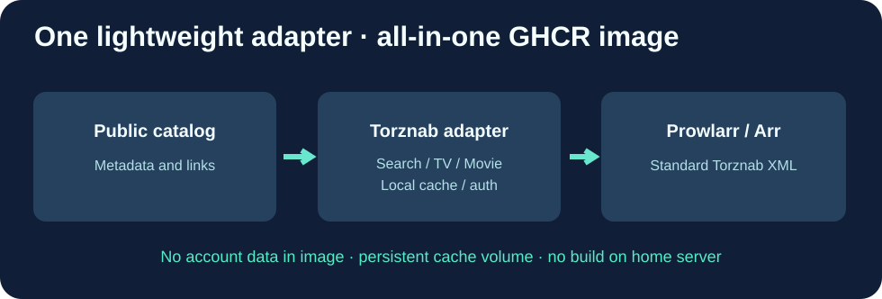

# Cloud9-Watchsomuch-Torznab

**Adaptateur Go de catalogue public vers Torznab, livré en image Docker GHCR précompilée.**

[English](README.md) · Français · [简体中文](README.zh-CN.md)

Application **autonome**, et non fork de Prowlarr ni de Jackett. Ces applications consomment déjà Torznab, mais ne réalisent pas cette conversion spécifique de catalogue.

## Fonctions conservées

| Fonction | Résultat |
|---|---|
| GET /health | Vérification de disponibilité |
| /api?t=caps | Capacités XML, films 2000 / séries 5000 |
| /api?t=movie | Recherche de films |
| /api?t=tvsearch | Séries, saison et épisode |
| /api?t=search | Recherche générale filtrée |
| /cache | Catalogue persistant, rafraîchissement après 6 h |

Les requêtes API nécessitent une clé TORZNAB_API_KEY ; les vérifications de santé sont publiques sur le réseau privé choisi. Pas de comptes personnels, pas de contournement des restrictions tiers ni de téléchargement automatique. Utiliser des contenus et sources autorisés.

## Distribution Cloud9

- Image **ghcr.io/godsquantum/cloud9-watchsomuch-torznab:latest** précompilée dans GitHub Actions pour amd64/arm64.
- Tests Go et HTTP pour sécurité API, XML Torznab, recherche vide et erreurs.
- Image Go statique minimale sans root, UID 1000, compatible lecture seule.
- Cache persistant et tags immuables pour retour arrière : mise à jour = simple Docker pull, sans build local.

## Installation

~~~bash
git clone https://github.com/GodsQuantum/Cloud9-Watchsomuch-Torznab.git
cd Cloud9-Watchsomuch-Torznab
cp .env.example .env
docker compose -f compose.example.yaml up -d
~~~

Remplacer la clé exemple par une valeur aléatoire secrète dans .env, puis configurer Prowlarr Torznab Custom sur le point d'accès /api dans un réseau de confiance.

Licence MIT. Projet communautaire indépendant de WatchSoMuch, sans données personnelles.
