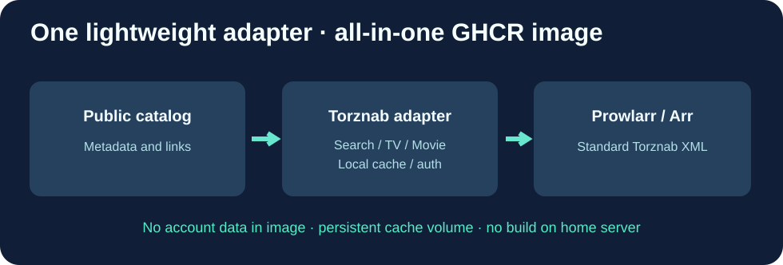

# Cloud9-Watchsomuch-Torznab

**A minimal public-catalog-to-Torznab adapter, distributed as a ready-to-pull GHCR Docker image.**

[English](README.md) · [Français](README.fr.md) · [简体中文](README.zh-CN.md)

This is an independent Go adapter, **not a fork of Prowlarr or Jackett**. Prowlarr consumes the Torznab protocol but does not perform this specific source's catalogue conversion.

## Functions

| Function | Behaviour |
|---|---|
| GET /health | HTTP 200 health check without API key |
| /api?t=caps | Torznab XML, Movies 2000 and TV 5000 |
| /api?t=movie | Movie search and relevant RSS links |
| /api?t=tvsearch | TV search, season and episode filters |
| /api?t=search | Bounded, query-filtered RSS results |
| /cache | Persistent 6-hour public metadata catalogue |

All API routes except health require a private TORZNAB_API_KEY. The adapter parses publicly accessible catalogue metadata and links; it does not circumvent paywalls, download content automatically, or store any personal accounts. Use only authorized content and lawful sources.

## What Cloud9 adds

- GitHub Actions builds amd64 / arm64 images and runs Go regression tests, a real Docker HTTP handshake, authorization checks and RSS/capability XML verification.
- **ghcr.io/godsquantum/cloud9-watchsomuch-torznab:latest**: no local Go compilation on updates.
- Small static scratch-based image, nonroot UID 1000, read-only filesystem compatible.
- Persistent Docker catalogue cache, bounded requests and immutable commit-image tags for rollback.
- Privacy audit; no keys, private network addresses, user accounts or personal data in this repository.

## Installation

~~~bash
git clone https://github.com/GodsQuantum/Cloud9-Watchsomuch-Torznab.git
cd Cloud9-Watchsomuch-Torznab
cp .env.example .env
# Edit .env and replace the sample key with a long random secret
docker compose -f compose.example.yaml up -d
~~~

In Prowlarr create a Torznab Custom indexer pointing to the /api route on the trusted Docker network with the matching API key. The example publishes only localhost, not the public internet.

This software is MIT licensed and not affiliated with WatchSoMuch. Upstream site metadata may change; deploy a known-good immutable image when tests fail.
