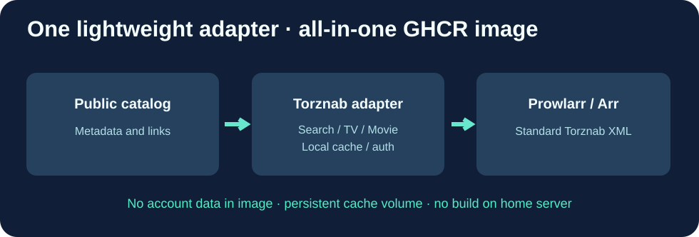

# Cloud9-Watchsomuch-Torznab

**将公开目录转换为标准 Torznab XML 的轻量级 Go 服务，提供 GHCR 预构建镜像。**

[English](README.md) · [Français](README.fr.md) · 简体中文

本应用独立维护，**不是 Prowlarr 或 Jackett 的分支**。Prowlarr 可以消费 Torznab，但不负责该公开目录的格式转换。

## 功能

| 功能 | 说明 |
|---|---|
| GET /health | 无需密钥的 HTTP 200 健康检查 |
| /api?t=caps | 标准 Torznab XML，电影 2000 / 电视 5000 |
| /api?t=movie | 电影搜索 |
| /api?t=tvsearch | 电视剧与季集筛选 |
| /api?t=search | 通用搜索、相关结果筛选 |
| /cache | 六小时目录缓存，升级后仍保留 |

除健康检查外所有 API 都需要私有 TORZNAB_API_KEY。该应用不会绕过付费访问或自动下载内容，请遵守版权及相关法律。

## Cloud9 的优化

- GitHub Actions 自动测试并发布 amd64/arm64 镜像，生产服务器只需拉取，**无需本地 Go 编译**。
- 真实 HTTP 和 Go 测试验证身份认证、Torznab XML、空结果 RSS 和错误处理。
- 最小静态镜像，非特权 UID 1000，支持只读文件系统。
- 持久缓存、不可变镜像标签和隐私扫描，无个人 IP、账户或密钥。

## 安装

~~~bash
git clone https://github.com/GodsQuantum/Cloud9-Watchsomuch-Torznab.git
cd Cloud9-Watchsomuch-Torznab
cp .env.example .env
docker compose -f compose.example.yaml up -d
~~~

在 .env 中替换默认示例密钥，使用可信的 Docker 网络将 Prowlarr Torznab Custom 索引器连接到 /api。示例端口仅绑定 localhost。

本项目采用 MIT 许可证，与 WatchSoMuch 无官方关联。
